# Petsagram 🐾 🐾 "One Scan Away from Home."

Petsagram is a pet safety and profile management platform designed to help pet owners keep all important pet information in one secure place.

With Petsagram, you can:

- Create rich pet profiles with photos and essential details
- Store veterinarian and emergency contact information
- Track vaccination records and medication history
- Generate unique QR code tags for pet collars
- Enable quick identification and owner contact if a pet goes missing

### Our why...

- ❤️ Cause they are more Than a Pet, A Lifeline Home.
- 🐾 Protecting Every Paw Print.
- 🏡 Helping Lost Pets Find Their Way Back Home.
- 🤝 When Every Second Matters, Every Scan Counts.
- 💕 Because They're Family.

Our mission is simple: help pet owners keep their pets safe, healthy, and easily identifiable.

## Checkout application demo

[Petsagram - Demo](https://www.loom.com/share/97f1df9bbdf3490daa58773142080e1f)

## Application Screenshot

#### Sign-In / Sign-up

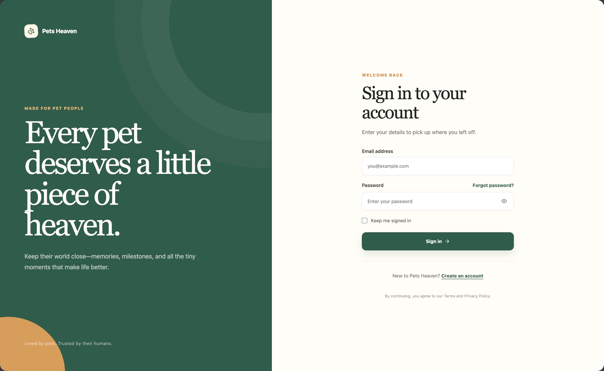

#### Petsagram Home

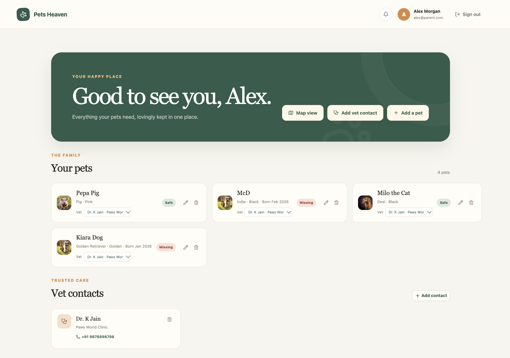
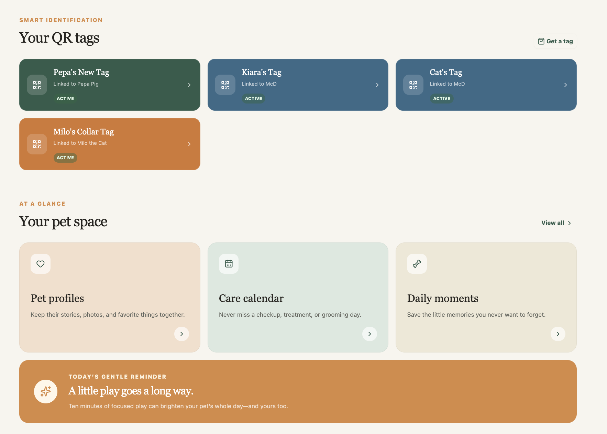

#### Pet's Information

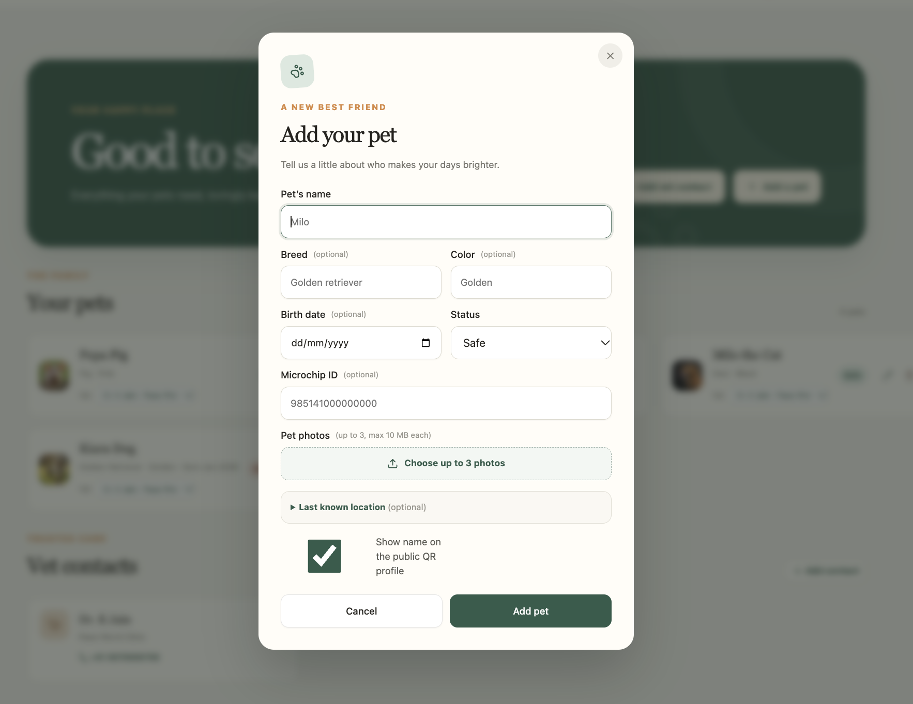
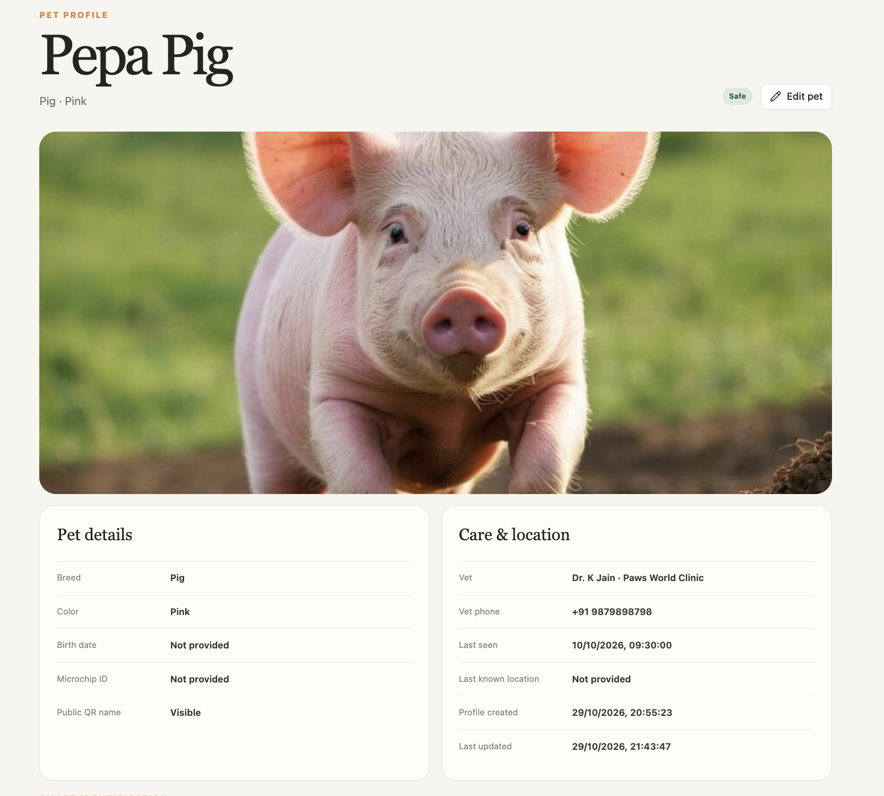
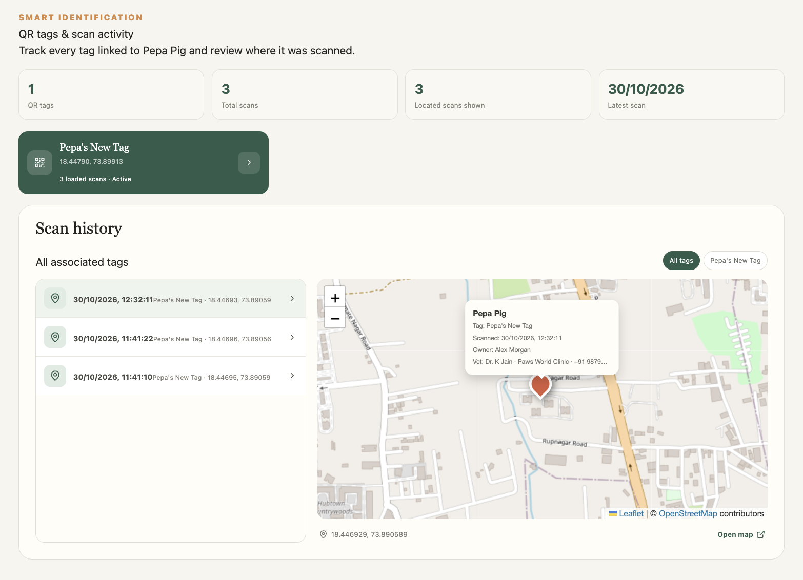

#### Pet's Public Profile

- This page comes when anyone scans the Pet's QR tag (publically available).
- Adds current location scan on with the QR Tag
  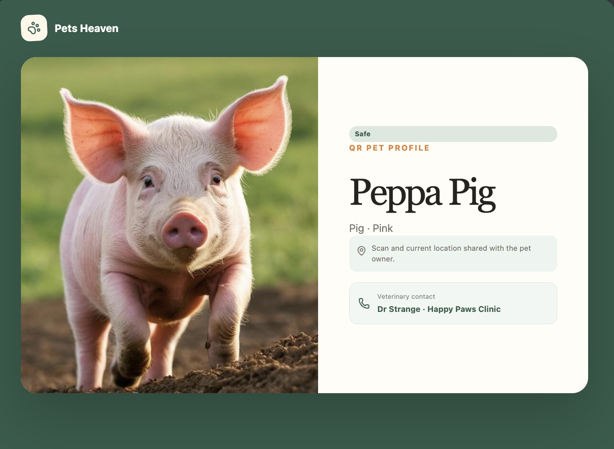

#### Vet's Info

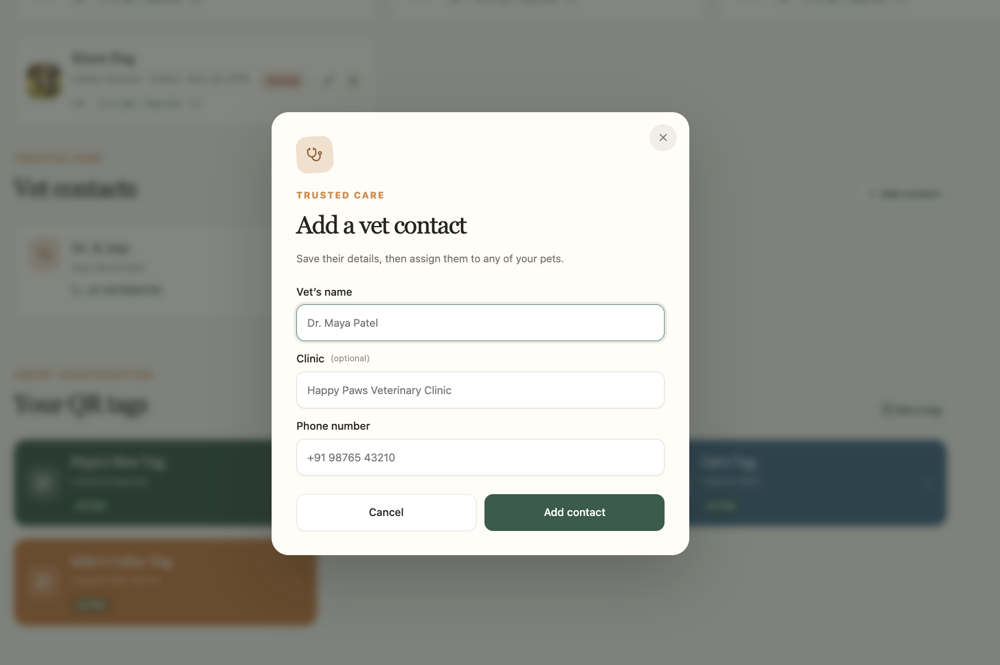

#### QR Tags

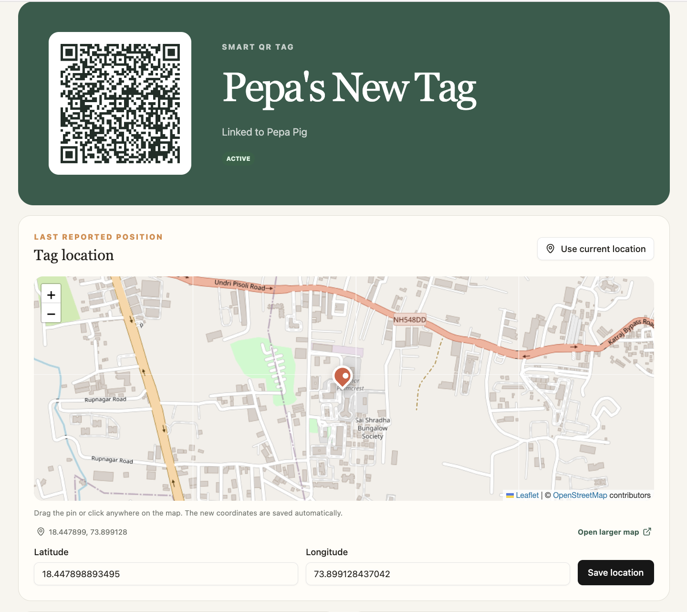
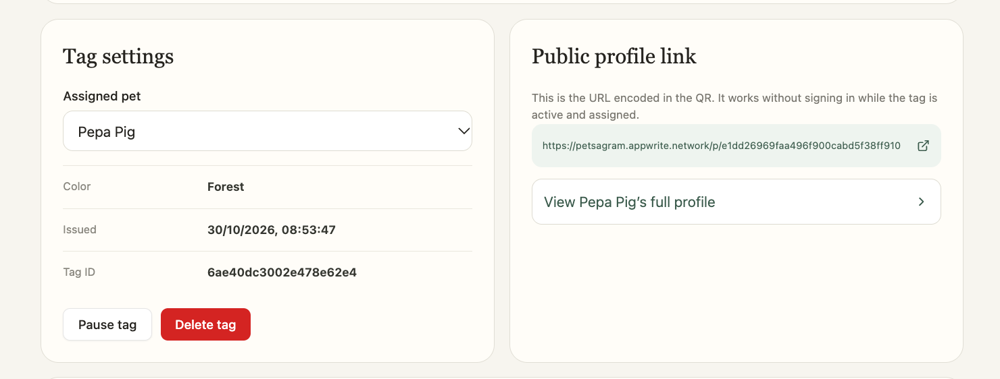
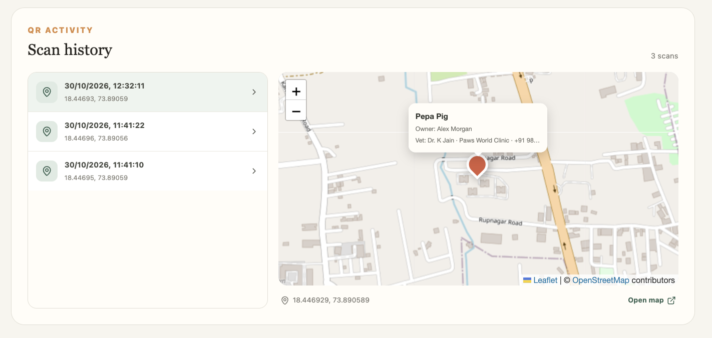
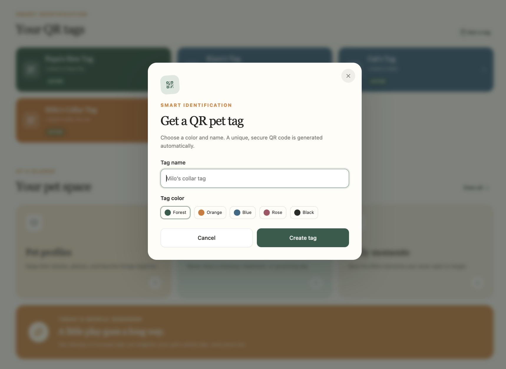

# Environment Configuration

Following configuration are required in your .env file

- REACT_APP_APPWRITE_ENDPOINT=
- REACT_APP_APPWRITE_PROJECT_ID=
- REACT_APP_APPWRITE_DATABASE_ID=
- REACT_APP_APPWRITE_STORAGE_ID=
- APPWRITE_API_KEY=

# Brewed using bun-react-tailwind-shadcn

To install dependencies:

```bash
bun install
```

To start a development server:

```bash
bun dev
```

To run for production:

```bash
bun start
```

To type check:

```bash
bun check
```

This project was created using `bun init` in bun v1.4.3. [Bun](https://bun.com) is a fast all-in-one JavaScript runtime.
